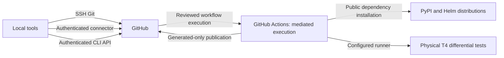

# Execution access map

<!-- toc:start -->
**Table of contents**

- [Execution access map](#execution-access-map)
<!-- toc:end -->

Which observed routes connect source review, CI and GPU verification?

Recorded utilization: **7 of 7 observed route classes (100%)** in this review
scope. CI and GPU edges are supported by the previously completed PR17 runs;
new-head CI and GPU benchmark execution remain pending. This is a bounded
projection, not the percentage of all known available routes: the complete Sight
inventory is unavailable. CI visibility does not provide direct runner SSH access.
