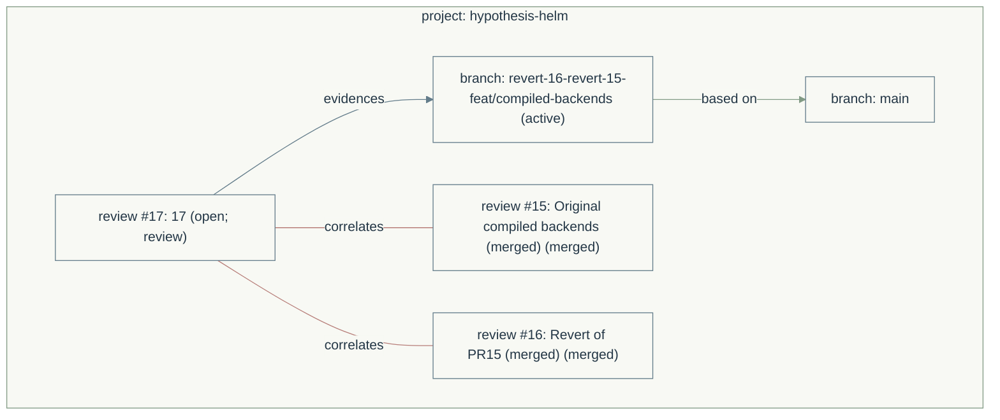

<!-- witful-work-graph:begin -->

Containment shows ownership; arrows name recorded relationships.

Associated work:

- [branch: revert\-16\-revert\-15\-feat/compiled\-backends](<https://github.com/astrivant/hypothesis-helm/tree/revert-16-revert-15-feat/compiled-backends>)
- [branch: main](<https://github.com/astrivant/hypothesis-helm/tree/main>)
- [review \#15: Original compiled backends \(merged\)](<https://github.com/astrivant/hypothesis-helm/pull/15>)
- [review \#16: Revert of PR15 \(merged\)](<https://github.com/astrivant/hypothesis-helm/pull/16>)
- [project: hypothesis\-helm](<https://github.com/astrivant/hypothesis-helm>)
- [review \#17: 17](<https://github.com/astrivant/hypothesis-helm/pull/17>)

<!-- witful-work-graph:end -->
