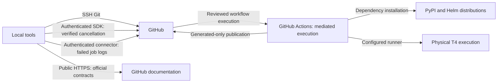

# Execution access map

<!-- toc:start -->
**Table of contents**

- [Execution access map](#execution-access-map)
<!-- toc:end -->

Which observed interaction routes supported this implementation and repair?

Recorded utilization: **8 of 8 observed route classes (100%)** in this review
scope. CI and physical GPU edges include preceding PR17 runs. The reported GPU
structural-sparsity shard failed during compilation and its run was cancelled
with verified cancellation. The new matched comparison has not run on hosted
hardware. Publication edges describe the preceding generated-results path.

This is a bounded observation projection. The percentage of all known available
Sight routes is **unavailable**, because the complete instance-scoped inventory
cannot be read by the installed runtime. Historical CI reachability does not
provide direct runner SSH access or authorize new execution.
