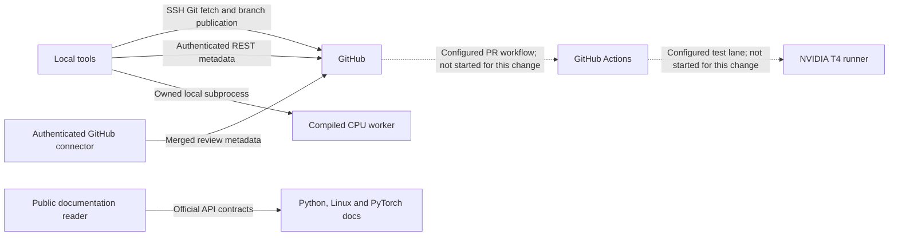

# Execution access map

<!-- toc:start -->
**Table of contents**

- [Execution access map](#execution-access-map)
<!-- toc:end -->

Which routes supported this implementation and local validation?

Five observed interaction route classes were used. Utilization as a percentage
of all known available Sight routes is **unavailable** because the installed
runtime cannot provide the complete instance-scoped inventory. Configured CI
edges are separate from observed execution and do not establish direct runner
SSH access. No benchmark or GPU workflow was dispatched for this change.
