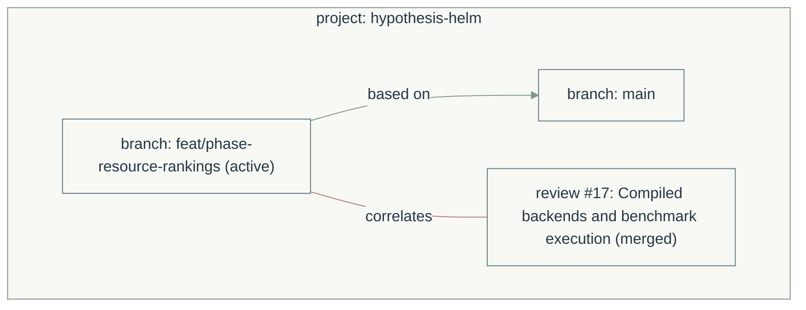

<!-- witful-work-graph:begin -->

Containment shows ownership; arrows name recorded relationships.

Associated work:

- [branch: feat/phase\-resource\-rankings](<https://github.com/astrivant/hypothesis-helm/tree/feat/phase-resource-rankings>)
- [branch: main](<https://github.com/astrivant/hypothesis-helm/tree/main>)
- [review \#17: Compiled backends and benchmark execution](<https://github.com/astrivant/hypothesis-helm/pull/17>)
- [project: hypothesis\-helm](<https://github.com/astrivant/hypothesis-helm>)

<!-- witful-work-graph:end -->
