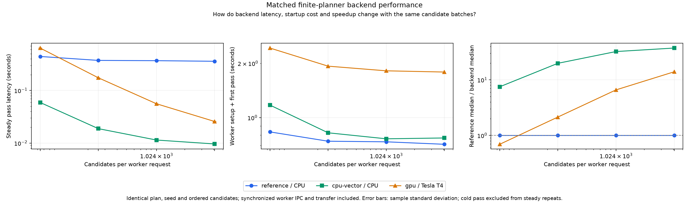

# Matched backend comparison

<!-- toc:start -->
**Table of contents**

- [Scope and timing](#scope-and-timing)
- [Observed hardware](#observed-hardware)
- [Reproduce from retained measurements](#reproduce-from-retained-measurements)
<!-- toc:end -->



Measured source: `e2fb6bc9f8cfe17a92d4b6f3d3546a7ceaff25cd`. Run: `43462155443`, attempt `1`.

All lanes use seed `2026`, 8,192 candidates, 24 Boolean factors and 5 steady repeats per batch size. Every ordered result matches an independent host oracle.

## Scope and timing

This suite measures finite-predicate evaluation through the production worker boundary. It does not measure end-to-end Helm rendering or claim that every study benefits from a GPU. Shared performance and sparsity studies still execute on CPU.

Steady latency includes packing, worker IPC, device transfers, synchronization and output decoding. Engine-reported time and host verification time are retained separately in the measurements. Cold time includes worker setup and the first full pass, including lazy compilation. The first pass warms the worker before steady repeats; worker setup is repeated for each batch-size case. Ratios compare medians on separate runners with their observed hardware below. No minimum speedup is required; slower GPU results remain valid evidence.

## Observed hardware

| Backend | Device | Accelerator | OS / architecture | CPUs | Python | NumPy | Compiler |
| --- | --- | --- | --- | ---: | --- | --- | --- |
| reference | reference | CPU | Linux / x86_64 | 4 | 3.13.18 | 2.5.4 | reference |
| cpu-vector | cpu | CPU | Linux / x86_64 | 4 | 3.13.18 | 2.5.4 | 0.68.1 |
| gpu | cuda | Tesla T4 | Linux / x86_64 | 4 | 3.13.18 | 2.5.4 | 2.15.0+cu132 |

## Reproduce from retained measurements

```sh
hypothesis-helm-benchmark backend-comparison report --input studies/backend-comparison/workload.json --lanes studies/backend-comparison/measurements.json --output .cache/backend-comparison-replot
```

The manifest and compact measurements are committed beside the plots. Missing lanes, fallback devices, changed source/workload, output mismatches and invalid durations reject publication.
